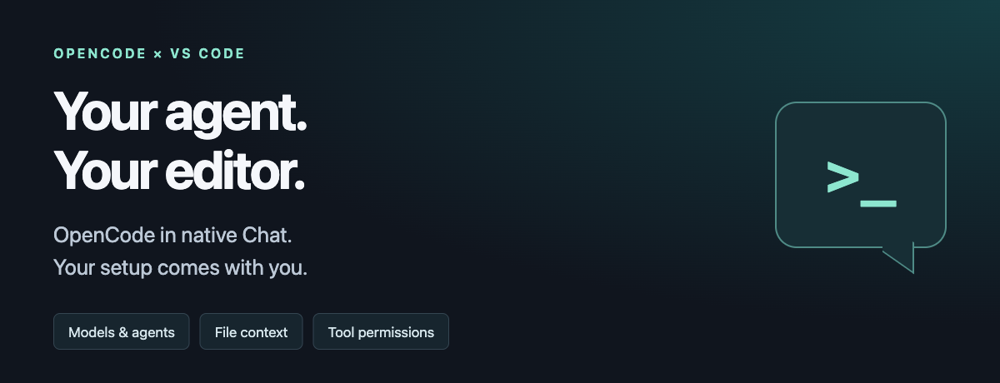

# OpenCode Native Chat

**Your OpenCode setup. Your models. Right inside VS Code Chat.**



Ask about your code, follow tool activity, and keep the conversation next to your editor. **OpenCode Native Chat** brings your local OpenCode agent into VS Code's native Chat through the Agent Client Protocol (ACP)—without a webview or a separate chat interface.

Keep the OpenCode configuration you already use: providers, credentials, agents, skills, MCP servers, and permissions. No second provider setup in the extension. No Copilot subscription required.

## Why OpenCode Native Chat?

- **Stay in your editor.** Stream answers, reasoning, and tool activity directly in native Chat.
- **Choose how you work.** Pick Model, Agent, and available Reasoning options from your session's OpenCode catalog.
- **Bring the right context.** Attach text files and selections, including unsaved changes, without copying them into your message.
- **Find your commands.** Discover session-specific slash commands through native `/` suggestions.
- **Stay in control.** Approve or reject requested tool permissions with Quick Pick. Stop a response and continue the conversation.
- **Pick up where you left off.** Reopen conversations created by the extension in the same workspace.

## Open your first chat

Once the extension is installed and proposed APIs are enabled:

1. Open a local project folder in VS Code and grant Workspace Trust only if you trust it.
2. Open the Command Palette: **Cmd+Shift+P** on macOS or **Ctrl+Shift+P** on Windows/Linux.
3. Run **OpenCode: New Native Chat Session**.
4. Choose a working directory when prompted. Your empty session opens in the Chat sidebar.
5. Choose the available session options, type your message, and press **Send**.

Try: **“Explain how this project is organized and where I should start.”**

Creating a session does not generate a response. OpenCode starts answering only on Send. The top **+** in OpenCode Chat uses the same New Session action.

## Installation and requirements

> **Experimental preview.** This build uses proposed VS Code APIs. It can be shared as a VSIX or run from source, but it is **not currently eligible for Marketplace publication** under Microsoft's [proposed API policy](https://code.visualstudio.com/api/advanced-topics/using-proposed-api#sharing-extensions-using-the-proposed-api).

You need:

- **VS Code 1.140.0**, the compatibility baseline. Other versions, including Insiders, may need API changes.
- **OpenCode V2** installed, with `opencode acp` available and provider authentication configured.
- An open, trusted **local workspace** with native VS Code Chat enabled.

To install a shared `.vsix` package, run **Extensions: Install from VSIX...** from the Command Palette. Then fully quit VS Code and launch your project with proposed APIs enabled:

```bash
code --enable-proposed-api=RabbitShare.opencode-native-chat /absolute/path/to/your/project
```

Use `code-insiders` for Insiders; the editor must still have compatible APIs.

Alternatively, enable proposed APIs for every launch through **Preferences: Configure Runtime Arguments**:

1. Open the Command Palette and run **Preferences: Configure Runtime Arguments**.
2. Add this property to the existing `argv.json` object. Preserve other properties and any existing extension IDs in the array:

   ```json
   "enable-proposed-api": [
     "RabbitShare.opencode-native-chat"
   ]
   ```

3. Fully quit VS Code and reopen it. **Developer: Reload Window** alone does not apply startup arguments.

Building from source? Follow [CONTRIBUTING.md](CONTRIBUTING.md#build-and-run).

## Use your OpenCode setup

### Models, agents, and reasoning

Use the inline **Model**, **Agent**, and **Reasoning** selectors to choose backend-confirmed options for the current session. Reasoning appears only when OpenCode offers effort choices. Selectors lock while a response or configuration change is pending.

The standard VS Code model entry **OpenCode (configured)** is a compatibility bridge—not your actual OpenCode model selection. Generic empty drafts use backend defaults until their first Send; use **OpenCode: New Native Chat Session** for selectors before sending.

### Files and selections

Attach a text file or selection using native Chat. Context included by the editor, such as the active file or viewport, is also sent to OpenCode. Current document text is used, including unsaved edits; selections and viewports send only their ranges. Opening another file does not automatically attach it.

Each Send supports up to **32 file references** and **1 MiB of combined UTF-8 text**. Unsupported or unreadable context fails explicitly before sending. The backend must advertise ACP `embeddedContext`. Accepting a remote document reference does not mean remote workspaces are supported.

### Slash commands

Type `/` in a created or reopened session to discover commands advertised by OpenCode. Currently, the extension expands supported local Markdown, JSON, and JSONC text templates before sending. Plugin, MCP, and other dynamic commands without a supported local template are rejected.

This is not full OpenCode command execution: built-in `/compact` without a local text template is unavailable, and a same-named template does not perform real compaction. See [template support and restrictions](docs/development.md#local-template-expansion).

## Settings

If VS Code cannot find OpenCode, set its executable path in **user settings**:

```json
{
  "opencodeNativeChat.command": "/absolute/path/to/opencode"
}
```

Use an executable path, not a shell command or arguments. The extension adds `acp` itself.

- **`opencodeNativeChat.env`**: environment overrides for the OpenCode process. Values must be literal strings; shell expressions are not evaluated. Defaults to `{}`.
- **`opencodeNativeChat.commandTemplateDirectories`**: fallback directories for local Markdown command templates. Relative paths use the session's working directory. This does not add commands to the advertised catalog.

The executable and environment settings are machine-specific, not workspace-configurable or synchronized. Run **Developer: Reload Window** after changing launch settings. Variables set only in an integrated terminal do not configure the extension host. Never disable TLS certificate validation as a routine fix.

## Good to know

- **OpenCode runs the tools.** Its permissions apply; the extension is not a sandbox. Approval prompts appear only when OpenCode requests them. Escape, dismissal, and cancellation never approve a tool.
- **Send follow-up messages instead of Edit or Retry.** These operations are rejected before an ACP prompt, even if the editor still exposes an entry point. After a rejected edit, reopen the saved session; reload the window first if necessary.
- **History stays with OpenCode.** VS Code stores only session metadata. The list shows sessions created by this extension in the current workspace, not your entire OpenCode history.
- **Text context only.** Binary attachments, session deletion, fork, and VS Code Undo integration are not implemented.
- **Sessions share a process.** A transport timeout or a hung cancellation can interrupt other sessions using that process.
- **Native verification is still in progress.** Selectors, New Session, and recovery have incomplete native UI checks. Automated tests do not establish compatibility with every editor build.

## Troubleshooting

**OpenCode executable not found?** Set `opencodeNativeChat.command` to an absolute executable path, then reload the window.

**`Language model unavailable` or Send is blocked?** Check the native model picker for **OpenCode (configured)** and select it if `Auto` remains. This is an editor-side bridge issue; changing OpenCode credentials will not fix it.

**Proposed API unavailable?** Check your editor version and launch arguments. Installing a VSIX alone does not enable proposed APIs. Changes to startup arguments require a full restart, not Reload Window.

**Need diagnostics?** Open **View: Toggle Output** and choose **OpenCode Native Chat**. Review logs for secrets before sharing them.

## Feedback and contributions

[Report a bug or suggest an improvement](https://github.com/RabbitShare/acp-to-chat/issues). Include the editor and OpenCode versions, reproduction steps, and sanitized diagnostics.

For source setup, checks, architecture, and demo assets, see [CONTRIBUTING.md](CONTRIBUTING.md).

Licensed under [MIT](LICENSE).
